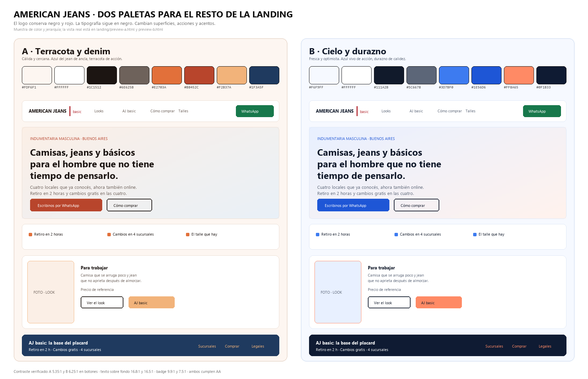

# Dos paletas para el resto de la landing

**Decisión pendiente:** elegir A o B. El logo y la tipografía no se tocan en ninguna de las dos.



---

## 1. Por qué cambia algo

La landing actual es negro de punta a punta. Eso tiene dos problemas concretos:

1. **Compite con el logo.** El logo ya es negro con marco rojo; si toda la página es negra, la marca no se distingue del fondo y el rojo pierde fuerza por repetirse.
2. **El negro total lee como "nocturno" o "premium"**, no como una marca de básicos con cuatro locales de barrio. La calidez y la cercanía se construyen con superficies claras y color, no con fondo oscuro.

Lo que **se mantiene igual** en las dos propuestas:

- El logo: negro `#0E0E0E` y rojo `#B0232B`.
- La tipografía: misma familia, mismo peso, texto en negro cálido.
- El rojo deja de usarse en botones y fondos: queda como color de marca, no como color de interfaz.
- El verde de WhatsApp: color funcional, igual en ambas (`#17784B`, AA 5,52:1).

---

## 2. Paleta A — "Terracota y denim"

**Sensación:** cálida, cercana, con oficio. Como un local de barrio que sabe lo que vende.
**Ancla conceptual:** el terracota dialoga con el denim y con la piel; el azul profundo es el jean.

| Rol | Hex | Dónde se usa | Contraste |
|---|---|---|---|
| Fondo | `#FDF6F1` | Lienzo de la página | — |
| Superficie | `#FFFFFF` | Header, tarjetas | — |
| Texto | `#1C1512` | Títulos y cuerpo | 16,8:1 |
| Texto suave | `#6E625B` | Bajadas, notas | 5,5:1 |
| Bordes | `#EBDCD1` | Líneas y separadores | — |
| **Acción** | `#B8452C` | Botón principal, numeración de pasos | 5,35:1 con blanco |
| Acción hover | `#9C3822` | Estado hover | 6,9:1 |
| Vivo | `#E2703A` | Cuadraditos de promesas, subrayados | decorativo |
| Acento | `#F2B37A` | Badge "Línea", títulos del footer | 9,9:1 con texto |
| Banda oscura | `#1F3A5F` | Sección AJ basic, footer | 11,5:1 con blanco |
| Tinte hero | `#FBEFE6` | Degradado del hero | — |
| Tinte 2 | `#E9F0F7` | Sección de talles | — |

**Riesgo conocido:** el terracota y el rojo del logo son ambos cálidos. En pantalla se diferencian (crimson oscuro contra naranja quemado), pero en una impresión barata pueden acercarse.

---

## 3. Paleta B — "Cielo y durazno"

**Sensación:** fresca, optimista, más joven. Como una marca digital que no se toma demasiado en serio.
**Ancla conceptual:** azul de confianza para la acción, durazno para la calidez humana.

| Rol | Hex | Dónde se usa | Contraste |
|---|---|---|---|
| Fondo | `#F6F9FF` | Lienzo de la página | — |
| Superficie | `#FFFFFF` | Header, tarjetas | — |
| Texto | `#111A2B` | Títulos y cuerpo | 16,5:1 |
| Texto suave | `#5C6678` | Bajadas, notas | 5,5:1 |
| Bordes | `#DCE6F5` | Líneas y separadores | — |
| **Acción** | `#1E56D6` | Botón principal, numeración de pasos | 6,25:1 con blanco |
| Acción hover | `#1745B0` | Estado hover | — |
| Vivo | `#3D7BF0` | Cuadraditos de promesas, subrayados | decorativo |
| Acento | `#FF8A65` | Badge "Línea", títulos del footer | 7,5:1 con texto |
| Banda oscura | `#0F1B33` | Sección AJ basic, footer | 17,1:1 con blanco |
| Tinte hero | `#E8F0FF` | Degradado del hero | — |
| Tinte 2 | `#FFF2ED` | Sección de talles | — |

**Riesgo conocido:** el azul de acción compite con el azul de las fotos de jean. Con un catálogo muy azul, el botón puede perder protagonismo.

---

## 4. Cuál elegir

| Si la marca va a ser… | Elegí | Porque |
|---|---|---|
| Un local de barrio con carácter, confianza y oficio | **A** | La calidez construye cercanía; el terracota no se parece a ninguna cadena |
| Una marca digital joven, con humor y energía en TikTok | **B** | El azul transmite confianza rápida y el durazno habilita el registro divertido |
| Un catálogo con muchas fotos de denim azul | **A** | El fondo cálido hace resaltar el azul de la prenda |
| Un catálogo con fotos muy neutras o en blanco | **B** | El azul aporta el color que la foto no tiene |

**Mi recomendación: A.**

El diferencial de American Jeans no es precio ni surtido: es que hay cuatro locales, retiro en dos horas y cambios gratis. Eso es una promesa de confianza y de oficio, y la paleta A la sostiene mejor. La B es más linda en un moodboard y más difícil de defender con un cliente de 45 años que compra un jean para trabajar.

La elección también define el tono del contenido: A va con la grilla tal como está (confianza, talle, ocasión); B pediría subir el humor y bajar el registro adulto.

---

## 5. Cómo se aplica (cinco minutos)

Los colores viven en un solo bloque de `styles.css` con nombres de rol (`--u-accion`, `--u-banda`, `--u-tinte`…). Cambiar de paleta es reemplazar ese bloque, no tocar componentes.

```
1. Abrir styles.css → bloque "PALETA ACTIVA"
2. Pegar los valores de theme-a.css o theme-b.css
3. Correr: python qa/verify_landing.py
4. Revisar landing/index.html en el teléfono
```

Verde de WhatsApp, rojo del logo y negro de la tipografía **no se tocan** en ninguno de los dos casos.

---

## 6. Qué se ve distinto en la página

| Antes (negro) | Ahora (A o B) |
|---|---|
| Header negro | Header blanco con borde suave |
| Hero negro con texto blanco | Hero en degradado cálido/fresco con texto oscuro |
| Botón rojo | Botón terracota (A) o azul (B) |
| Badges negros | Badges en acento cálido con texto oscuro |
| Todo el sitio oscuro | Una sola banda oscura (AJ basic + footer) para dar ritmo |

Un solo bloque oscuro por página es lo que hace que el resto parezca luminoso. Si todo es claro, no hay contraste; si todo es oscuro, no hay marca.
